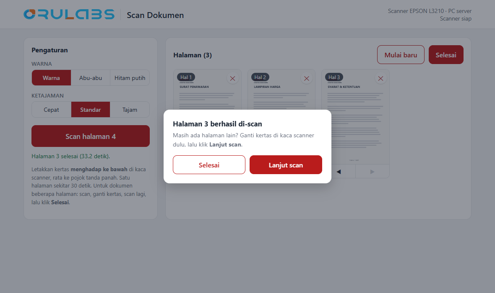
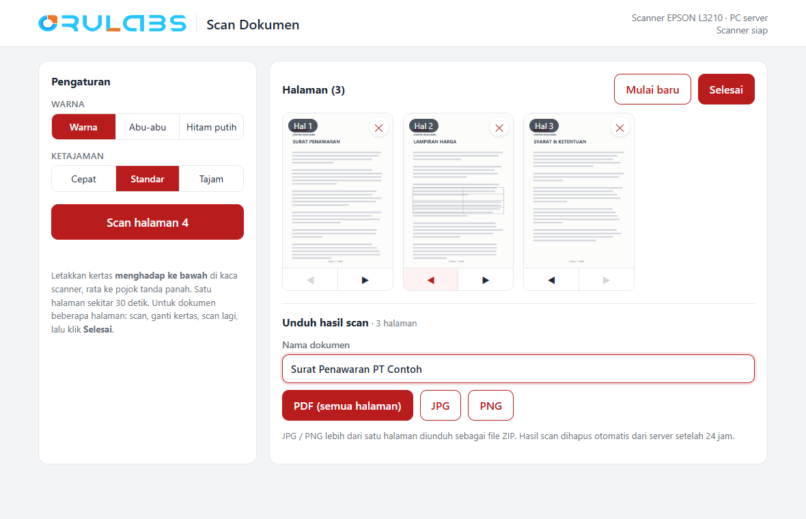
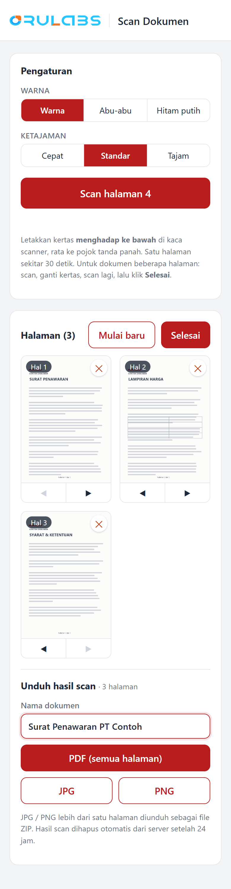

# Scan Kantor

Halaman scan sederhana untuk printer **EPSON L3210** yang terpasang (USB) di PC
server 192.168.120.229. Siapa pun di jaringan kantor membuka
**http://192.168.120.229:8500**, menaruh kertas di kaca scanner, klik **Scan
halaman** (bisa beberapa halaman), lalu **Selesai** dan unduh:

- **PDF**: semua halaman jadi satu file;
- **JPG** / **PNG**: satu file per halaman (ZIP kalau lebih dari satu).

Pilihan: Warna / Abu-abu / Hitam putih, dan Cepat (150 dpi) / Standar (200) /
Tajam (300). Satu halaman sekitar 30 detik.

Setelah tiap halaman muncul pilihan **Lanjut scan** atau **Selesai**. Urutan
halaman bisa diubah (tombol ◀ ▶ atau seret), dan dokumen bisa diberi nama
sebelum diunduh.

## Tampilan

Halaman contoh di bawah ini fiktif (bukan hasil scan asli).

| Setelah scan: lanjut atau selesai | Atur urutan, beri nama, unduh |
|---|---|
|  |  |

<p align="center"><br><sub>Tampilan di HP</sub></p>

## Cara kerja

- `scan_server.py`: server web, **hanya pustaka bawaan Python** (tanpa pip).
- `scan_page.ps1`: scan satu halaman lewat WIA Windows (driver Epson Scan 2),
  disimpan sebagai JPG + PNG.
- Satu scanner = satu antrean: kalau sedang dipakai, pengguna lain diberi tahu.
- Hasil scan di `data\` dihapus otomatis setelah 24 jam.
- Sesi scan disimpan di browser (halaman tetap ada walau halaman dimuat ulang).

## Pasang / update di server

Salin folder ini ke `C:\Users\TCI-PC-010\office-scan`, lalu PowerShell
**Run as Administrator**:

```powershell
Set-Location C:\Users\TCI-PC-010\office-scan
powershell -ExecutionPolicy Bypass -File .\install_service.ps1
```

Membuat service `OfficeScan` (nssm, otomatis jalan saat server menyala), rule
firewall port 8500, lalu mengecek halaman merespons. Log: `logs\service.log`.

## Uji di laptop (tanpa scanner)

```powershell
$env:SCAN_FAKE = "1"; $env:SCAN_PORT = "8501"; python scan_server.py
python -m pytest test_scan_server.py
```
